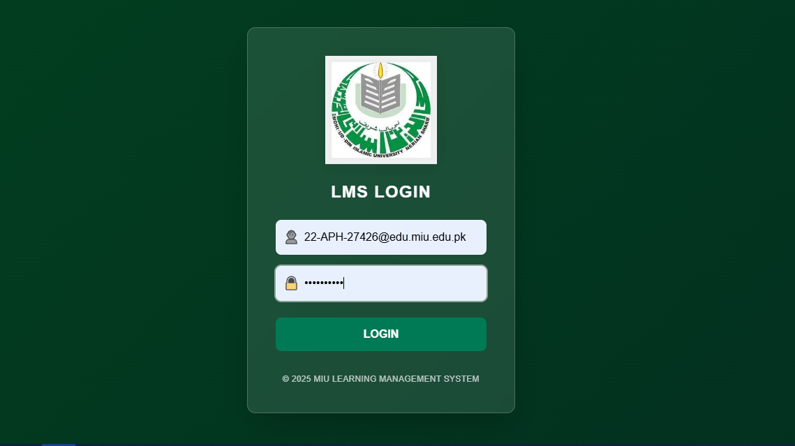
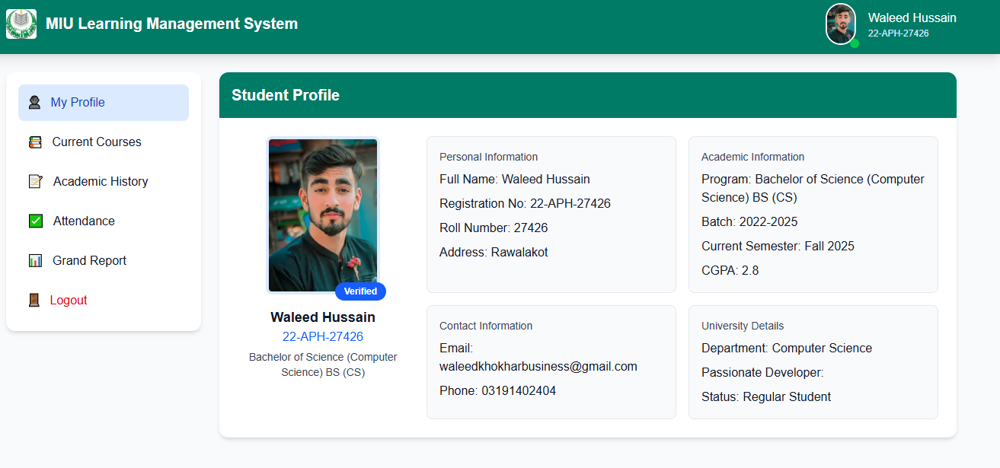
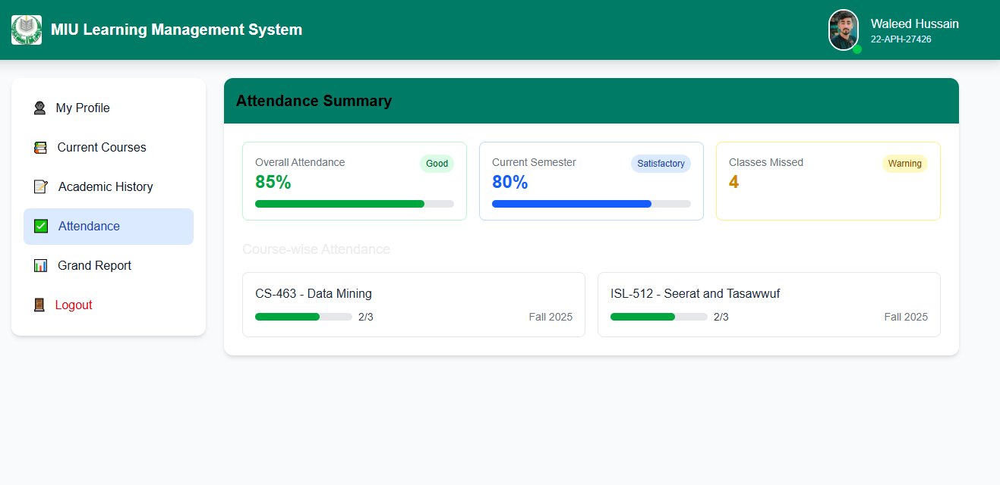

# 🎓 MIU LMS — University Learning Management System

> A clean, modern **Learning Management System** interface for MIU (Mohi-ud-Din Islamic University) — built with **Next.js** to help students view academic profile, courses, grades, and reports in one place.

[](https://nextjs.org/)

---

## 🎯 What is this project?

**MIU LMS** is a university student portal — showing academic history, semester grades, CGPA tracking, course enrollment, and attendance in a clean, responsive UI.

---

## 🔗 Project Links

| Platform | Link |
|---|---|
| 🌐 Live Demo | [miulmsportal.vercel.app](https://miulmsportal.vercel.app/) |
| 📦 GitHub Repo | [github.com/waleedkhokar](https://github.com/waleedkhokar) |

---

## 📸 Screenshots

| | | |
|---|---|---|
|  |  |  |
| **Login** | **Student Details** | **Details** |

---

## ✨ Features

- 👤 **Student Profile** — Personal, academic & contact info
- 📚 **Current Courses** — Enrolled semester courses with attendance
- 📝 **Academic History** — Complete course record (44 courses, 41 passed)
- 📊 **Grade Report** — Semester-wise GPA, CGPA & credit hours
- ✅ **Attendance Tracking** — Per-course attendance view
- 🔐 **Login / Sign Up** — Auth flow included

---

## 🚀 Getting Started

```bash
git clone https://github.com/waleedkhokar/university-lms-portal.git
cd university-lms-portal
npm install
npm run dev
```

Open [http://localhost:3000](http://localhost:3000)

---

## 👨‍💻 About the Developer

### **Waleed Khokhar**

> **Full-Stack Engineer | MERN Stack | Python & FastAPI | TypeScript**

I build scalable, production-ready web applications using **Next.js, React, Node.js, Python/FastAPI, TypeScript/JavaScript**, and both **SQL & NoSQL** databases — with **Docker** for containerization.

**🌐 Connect with me:**

[](https://www.linkedin.com/in/waleedkhokhar)
[](https://github.com/waleedkhokar)
[](https://waledkhokar.vercel.app/)
[](mailto:waleedkhokharbusiness@gmail.com)

---

> **وَقُل رَّبِّ زِدْنِي عِلْمًا**
>
> *"And say: My Lord, increase me in knowledge."*
> — Surah Taha (20:114)

---

## 📄 License

MIT Licensed — free for personal and commercial use.

---

**Built with ❤️ by Waleed Khokhar | Full-Stack Engineer | MERN Stack | Python Developer**